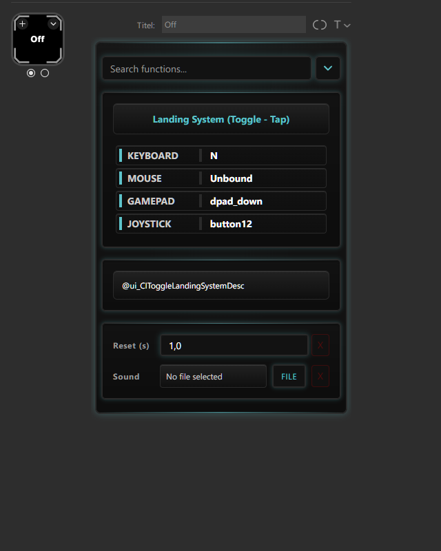

# Usage

## Adaptive Key

Use `Adaptive Key` for bindings you want to trigger in Star Citizen.
This is the most common key type you will use.

Basic flow:

1. Drag `Adaptive Key` onto a Stream Deck key.
2. Click on it to open the Property Inspector.
3. Select the Star Citizen function you want.
4. (Optional) Select a sound file (.wav/.mp3) from your system.

{ style="width:50%; height:auto;" }

## Toggle Key

Use `Toggle Key` for bindings that have two states (e.g., landing gear up/down).
You can also set a Reset threshold to resync the key state if it gets out of sync with the game.
While you can use all functions with Toggle Keys, they are best suited for functions that have a clear On/Off state.

Basic flow:

1. Drag `Toggle Key` onto a Stream Deck button.
2. Click on it to open the Property Inspector.
3. Select the Star Citizen function you want.
4. (Optional) Set a Reset threshold (from 0.2 to 10 seconds, default is 1). This defines how long you need to hold the key to reset its state (On → Off or Off → On).
5. (Optional) Select a Sound file (.wav/.mp3) from your system.

{ style="width:50%; height:auto;" }

## Telemetry Display Key

Use `Telemetry Display` to show a live value from Star Citizen's local telemetry API (vitals, environment, ship state and more) and change the key's text, image and colors based on that value.
For example, show `Pressure` and switch to a "low pressure" image below a threshold.

Requirements:

- The game's telemetry server must be enabled (it is off by default). See the [telemetry setup guide](https://github.com/Jarex985/SCStreamDeck/blob/main/PluginCore/Protos/README.md).
- Your character must have spawned. Until then the key shows the default appearance with `—`.
- Ship values (speed, shields, ...) only exist while you are seated; about 3 seconds after you leave the seat the key falls back to its Default section.
- The list of attributes is read from the installed game (`StarCitizen.exe` of the channel you selected in the Control Panel), so it always matches your game version. If the game cannot be found, a built-in list is used. The protocol that was read is exported next to the plugin log as `telemetry-protocol.proto` (readable) and `telemetry-protocol.desc` (binary, for `grpcurl -protoset`).

Basic flow:

1. Drag `Telemetry Display` onto a Stream Deck key and open the Property Inspector.
2. Search and select the attribute to show (for example `Actor Vitals › Pressure`). Gauges (health, oxygen, ...) also offer a `percent` value.
3. (Optional) Set a Label (used for `{label}`) and the number of Decimals.
4. Add Rules. The first rule whose condition matches wins:
    - Numbers: is less than / at most / greater than / at least / between / equals / does not equal
    - On/Off values and enums (for example `Locomotion`): is / is not
    - Per rule: Text (`{value}` and `{label}` are replaced, `\n` is a new line), Image (.png/.jpg/.bmp/.gif), Text and Back colors, an optional Flash, and an optional Press action
    - Sound: a .wav/.mp3 played once each time the rule becomes the active one (not for the Default section, and not when the key first appears)
    - Flash: enter a time in ms (minimum 250). While that rule is active the flashed part is shown for that long, then hidden for the same time, repeating. Empty = no flashing. **Flashes** chooses what blinks: **Text** (default; background and image stay), **Background + image** (the text stays; the background and image turn black while off) or **Everything** (all blink; the key is black while off)
5. The Default section is used when no rule matches or there is no data.
6. (Optional) Select a Press sound (.wav/.mp3), played when a press action runs.

Press actions use the same keybindings as `Adaptive Key`, run for the rule that is active when you press the key, and only run while telemetry data is available.

## Advanced Telemetry Display Key

Use `Advanced Telemetry Display` when a state depends on **several attributes at once**, for example a warning light that appears only when the ship is **landed AND low on hydrogen fuel**.
It has the same text, image, color, flash, sound and press-action options as `Telemetry Display`; only the rule conditions differ.

1. Drag `Advanced Telemetry Display` onto a key and open the Property Inspector.
2. (Optional) Pick a Display attribute. It only feeds `{value}` and `{label}` in the rule texts.
3. Add a Rule and build its **When** part: choose `All of these (AND)` or `Any of these (OR)`, then add conditions. Each condition has its own attribute, operator and value (for example `Is Landed` is `On`, `Hydrogen Fuel` is less than `20`).
4. In a rule's Text you can print any attribute with `{value:attribute.path}`, for example `REFUEL\n{value:vehicle.state.flight.instruments.hydrogen_fuel}`.
5. Rules are checked in order and the first one that matches wins. A condition on an attribute that has no data (for example ship values while you are on foot) is false, so such a rule does not match. The Default section applies when no rule matches.
6. Each rule (and the Default section) has a **Press** list: add one or more actions, optionally with a delay in ms before each one. When you press the key, the actions of the rule that is active at that moment run in order. A single action without a delay behaves like `Adaptive Key` (it is held while you hold the key); with several actions or a delay, each step is a short tap. Pressing again while a sequence is still running is ignored. An action can also switch a [flag](#flags) instead of running a Star Citizen action.
7. A rule can also switch [flags](#flags) when it becomes active (**Sets flags**), and its conditions can test them.

Example toggle on one key: Rule 1 = `Gear` is `Deployed` shows "Gear DOWN" and presses the landing gear action; the Default section shows "Gear UP" and presses the same action, so the key always shows and does the right thing.

Example warning light: Rule 1 = ALL of `Is Landed` is `On`, `Hydrogen Fuel` is less than `20`; set a red image, Flash `1000` and a sound.

## Deceleration Key

Use `Deceleration` to see how far you will still travel, and how long it will take, until a value reaches zero while it is dropping. For the ship's speed in m/s the cumulative units are meters, so the key answers "how much distance do I need to stop?".

1. Drag `Deceleration` onto a key and open the Property Inspector.
2. Pick a numeric attribute (for example `Vehicle State Flight Instruments › Speed`).
3. Set the **Estimate** mode (see below) and, for the live rate, the **Window** (ms, default 1000): the key compares the value now with the value one window ago. A longer window gives a steadier estimate, a shorter one reacts faster.
4. Choose what to **Show**: units and time, units only, or time only. **Divide by** changes the order of magnitude of the units (1000 turns meters into kilometers; pick a preset or type your own) and **Unit** is the suffix shown after them, for example `km`. **Round units** / **Round time** round to a multiple in the displayed unit (for example 0.5 shows 2.0 km instead of 1.96 km, 50 shows 1,950 m instead of 1,963 m); empty keeps one decimal.
5. Rules work like those of `Advanced Telemetry Display`: each rule combines conditions (all / any) on **any attributes** and on the estimate itself (`Estimate (units)` in the displayed unit, `Estimate (time, s)`). Example: "Estimate (units) is less than 2 AND Is Landed is Off" turns the key red when you are braking within 2 km of standing still while flying. A condition on the estimate is false while there is no estimate. Rules, images, colors, flash, sounds and several press actions per rule work as on the advanced key. Texts can use `{units}`, `{time}`, `{value}` (the selected output), `{label}` and `{value:attribute.path}` for any attribute. Rules saved earlier with a single comparison are converted to a condition on the estimate when you open the settings.

The **Estimate** option decides how the value is estimated. For the ship's speed the default (`Automatic`, same as `Recorded runs`) uses the deceleration your ship actually showed:

1. Press the key. It shows `Armed`; the plugin waits until the speed starts falling from a steady speed of at least 20 m/s.
2. Release the throttle and let the ship slow to a stop. The key shows `REC` and the speed, and `Saved` with the number of runs for this ship when the speed reaches zero.
3. From then on the key shows the distance and time to stop from the current speed, using the recorded runs of the same ship and master mode (SCM and NAV decelerate differently) at about the same atmospheric density; densities between two recorded ones are interpolated. Record runs at different speeds and in atmosphere to improve it. Newer runs weigh more, which follows changes in cargo or loadout. A leading `~` means the estimate goes beyond the recorded speeds or densities.

The **Armed**, **Recording**, **Saved** and **Discarded** states each have their own look at the bottom of the Property Inspector (text, image, sound, format template, colors, flash, flags). While one of them is shown it replaces the rules and the Default look; pressing the key still runs the press action of the rule that would otherwise apply. Their texts can use `{state}`, `{speed}` (m/s), `{runs}` (for example `3 runs`, after a save), `{reason}` (after a discard), `{label}` and `{value:attribute.path}`; empty uses `Armed / release / throttle`, `REC` and the speed, `Saved` and the run count, `Discarded` and the reason. Saved and Discarded stay for four seconds.

A run is discarded when the speed rises again, you boost, land or change ship, the speed stops falling for 10 seconds, or you press the key again while armed or recording (that press only cancels and does not run the rule's press action; the press that arms the recording still runs it). Without a recorded run for the current ship the key shows `—`. Profiles are stored in `%APPDATA%\SCStreamDeck\deceleration-profiles.json`, so they survive plugin updates.

**Live rate** (and any attribute other than speed) assumes the value keeps dropping at the rate seen over the window: time = value / rate and units = value² / (2 × rate). It needs one full window of history first, and while the value is not clearly decreasing (constant, increasing, already zero, or no data) the key shows `—` and uses the Default section.

## UEC Tracker Key

Use `UEC Tracker` to watch your in-game UEC balance and how much you earned or lost during the session.

1. Drag `UEC Tracker` onto a key. The first line is your current balance; the second line is the change since the session started, in accounting style: `800` in green for a gain, `(800)` in red for a loss, plain `0` when nothing changed. Both lines are abbreviated to keep the text large: from 1,000 as `1.5k` (up to one decimal), from 1,000,000 as `1.25m` and from 1,000,000,000 as `1.25b` (up to two decimals), for example `(12k)` for a loss.
2. **Press the key** to reset the count: the change restarts at 0 from your current balance.
3. A new session also starts by itself when the balance was unavailable for more than a minute (for example the game was restarted). All `UEC Tracker` keys share the same session.
4. Rules, images, colors, flash, sounds and **format templates** work as on `Advanced Telemetry Display` and style the whole key and the balance line; only the change line is colored green/red. Rules can test the balance (`Actor State › Uec Balance`) and the change (`UEC › Session change`). Texts can use `{value}` (balance), `{change}`, `{label}` and `{value:attribute.path}`; the default text is `{value}\n{change}`.

The key needs the game's telemetry server to be enabled and shows `—` while no balance is received.

## Travel Timer and Travel Display Keys

Use `Travel Timer` and `Travel Display` to measure how long something takes and how far you travelled meanwhile, for example to record a trip or to find the distance needed for a smooth approach, departure or maneuver in a tight space.

1. Drag `Travel Timer` onto a key. It has three looks, each with its own text, image, colors, **format template**, flash and sound (and extra press actions for Start and Stop):
    - **Start**: shown while a measurement can be started (default text `Start`, also after a stop). Pressing the key resets the values and starts a measurement.
    - **Stop**: shown while measuring (default text `Stop`). Pressing the key stops it and the values freeze.
    - **Unavailable**: a list of rules (conditions on any attribute, like `Advanced Telemetry Display`; default text `Unavailable`). While one of them matches, the key shows that rule's look and does nothing when pressed, so you decide when the key is shown and usable, for example "Speed is greater than 10". Without rules the key is always available. Be aware that an unavailable key cannot stop a running measurement either.
2. Drag `Travel Display` onto another key. It shows the **elapsed time in minutes and tenths of a minute** (`3.4 min`) and the **estimated distance** in whole meters (`850 m`), switching to kilometers with two decimals from 1 km (`1.26 km`). It shows `—` until a measurement was started. Like the timer it has a **Display** look (default text `{elapsed}\n{distance}`, with image, colors, format template, flash, sound and press actions) and an **Unavailable** list of rules: while one matches, the key shows that rule's look and does nothing when pressed.
3. The distance is the ship's speed (`Vehicle State Flight Instruments › Speed`) integrated over time: every telemetry update adds the average of the previous and the current speed multiplied by the time between them (trapezoid rule). That is more exact than multiplying the latest speed by the time, and because speed is a magnitude it follows the path you flew (turns and back-and-forth moves add up) rather than the straight line between start and end. The measurement keeps counting while the keys are not on the visible page. Time without speed (you left the seat, or the game stopped sending telemetry) is not counted, so the distance can then be lower than the real one; the elapsed time always keeps running until you stop.
4. Conditions in the Unavailable rules of both keys can test `Travel › State` (Idle, Running, Stopped), `Travel › Elapsed (min)` and `Travel › Distance (m)`, besides any telemetry attribute. Texts can use `{elapsed}`, `{distance}`, `{state}`, `{label}` and `{value:attribute.path}`. All travel keys share one measurement.

Both keys need the game's telemetry server to be enabled.

## Config Key and format templates

Use the `Config` key to create what the telemetry keys share. Drag `Config` onto any key (it does nothing when pressed) and open its Property Inspector; it has two sections: **Flags** (see [Flags](#flags)) and **Format templates**. Templates are no longer edited on the telemetry keys themselves, which only pick them.

All telemetry keys (`Telemetry Display`, `Advanced Telemetry Display`, `Deceleration`, `UEC Tracker`, `Travel Timer`, `Travel Display`) can use a template. A template is a named look that bundles **text color, background color, image and flash interval**, for example a `warning` template with yellow text on red that flashes every 500 ms.

1. On the `Config` key click **New template**, give it a name and set colors, image and flash.
2. On a telemetry key, in any rule (or the Default section), pick it in the **Template** row.
3. Change the template once and every rule using it, on every telemetry key, follows.

Anything you set on the rule itself (its own colors, image or flash) overrides the template, so a rule can use a template and still differ in one detail. Templates are shared by all telemetry keys (they are stored in the plugin's global settings, not in the key, so they are not part of an exported profile). Deleting a template makes rules that used it fall back to their own settings. Templates you made before this version are still there; only the place to edit them moved.

Stream Deck can lose the plugin's global settings when the plugin is installed again, so the plugin also keeps a copy of the templates in `%APPDATA%\SCStreamDeck\telemetry-format-templates.json` and restores it when a `Config` or telemetry key finds no templates at all. If you delete every template on purpose, the copy is emptied too and nothing is restored.

## Flags

A flag is a named on/off switch shared by all telemetry keys, for example a **master warning** or **preflight check done**. Rules can test a flag, rules can switch it, and a key press can switch it.

1. On the `Config` key click **New flag**, give it a name and choose its **Starts** value (On/Off). Flags are stored in the plugin's global settings (a copy is kept in `%APPDATA%\SCStreamDeck\telemetry-flags.json`, restored like the templates). The values themselves are not saved: every flag returns to its Starts value when the plugin restarts.
2. **Test a flag**: in the conditions of an `Advanced Telemetry Display` rule (also on `Deceleration`, `UEC Tracker` and the travel keys) pick the attribute `Flags › <name>` and compare it with On or Off. A flag always has a value, so such a rule works without telemetry.
3. **Switch a flag from a rule**: each rule (and the Default section) has a **Sets flags** row. Add a flag and choose On or Off; it is applied **once each time that rule becomes the active one** (like its sound; not when the key first appears or you edit the settings; the Default section only while telemetry data is available). Rules are only evaluated while the key is on the visible Stream Deck page.
4. **Switch a flag when the key is pressed**: in the **Press** list of an `Advanced Telemetry Display` rule add an action, change its type from `Star Citizen action` to `Flag`, pick the flag and choose Toggle, Set on or Set off. Flag actions also work without telemetry and can be mixed with Star Citizen actions and delays in one list.

Example master warning: create the flags `Master warn` and `Preflight`.

- On the key that watches fuel, add a rule "Hydrogen Fuel is less than 20" and, in **Sets flags**, `Master warn` On.
- Put an `Advanced Telemetry Display` named MASTER WARN on the same page. Rule 1: condition `Flags › Master warn` is `On`, red template with Flash `500` and a sound; **Press**: Flag `Master warn` Set off (this acknowledges the warning). The Default section shows nothing special.

Example preflight switch: an `Advanced Telemetry Display` with Rule 1: `Flags › Preflight` is `On`, text `PREFLIGHT\nDONE` in green; the Default section shows `PREFLIGHT\nTODO` in amber. Both have a **Press** action: Flag `Preflight` Toggle. Another rule, "Speed is greater than 10" with **Sets flags** `Preflight` Off, makes the switch fall back to TODO once you take off, so it asks for the next flight's check.

## Telemetry Debug Key

Use `Telemetry Debug` to find out why a telemetry attribute does not show up. Press the key to switch the capture on (red, `DEBUG ON`, with the stream state and the number of frames received) or off (grey):

1. While it is on, raw frames of the game's telemetry stream are written, at most one every 2 seconds, to `telemetry-debug.log` in the folder of the plugin log (it is overwritten each time you switch it on).
2. Every line shows the protobuf field number, the name from the protocol and the value. Fields the game sends that the protocol does not know are marked `NOT IN SCHEMA`, and fields sent with another wire type than the protocol says are marked `WIRE TYPE MISMATCH`.
3. Fields the game leaves out are listed as `not sent, so 0/false/default` (proto3 does not send a value of 0). If you do see `0` on a key but expect another value, this is the place to check whether the game sent it.
4. When you switch it off, a summary lists the protocol attributes that were never sent during the capture.

The file stops growing at 5 MB. The key also keeps the telemetry connection open, so it works without any other telemetry key on the deck.

## Control Panel Key

Use `Control Panel` for global plugin settings:

- Theme
- Channel (`LIVE`, `HOTFIX`, `PTU`, `EPTU`)
- Custom installation paths (if auto-detection fails)
- Force Redetection
- Factory reset

{ style="width:50%; height:auto;" }

!!! note "What Force Redetection & Factory Reset do"
    - **Force Redetection**: Re-runs the auto-detection of your Star Citizen installation path and keybindings. Use this if you moved your installation or changed keybindings in-game.
    - **Factory Reset**: Clears cached installs, your current theme, and custom overrides, then rebuilds keybindings.
