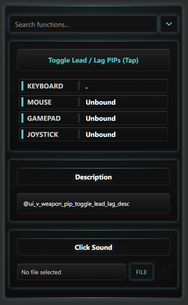
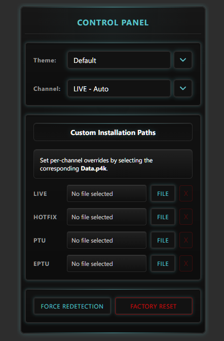

# Usage

## Adaptive Key

Use `Adaptive Key` for bindings you want to trigger in Star Citizen.
This is the most common key type you will use.

Basic flow:

1. Drag `Adaptive Key` onto a Stream Deck key.
2. Click on it to open the Property Inspector.
3. Select the Star Citizen function you want.
4. (Optional) Select a sound file (.wav/.mp3) from your system.

{ style="width:50%; height:auto;" }

## Toggle Key

Use `Toggle Key` for bindings that have two states (e.g., landing gear up/down).
You can also set a Reset threshold to resync the key state if it gets out of sync with the game.
While you can use all functions with Toggle Keys, they are best suited for functions that have a clear On/Off state.

Basic flow:

1. Drag `Toggle Key` onto a Stream Deck button.
2. Click on it to open the Property Inspector.
3. Select the Star Citizen function you want.
4. (Optional) Set a Reset threshold (from 0.2 to 10 seconds, default is 1). This defines how long you need to hold the key to reset its state (On → Off or Off → On).
5. (Optional) Select a Sound file (.wav/.mp3) from your system.

{ style="width:50%; height:auto;" }

## Telemetry Display Key

Use `Telemetry Display` to show a live value from Star Citizen's local telemetry API (vitals, environment, ship state and more) and change the key's text, image and colors based on that value.
For example, show `Pressure` and switch to a "low pressure" image below a threshold.

Requirements:

- The game's telemetry server must be enabled (it is off by default). See the [telemetry setup guide](https://github.com/Jarex985/SCStreamDeck/blob/main/PluginCore/Protos/README.md).
- Your character must have spawned. Until then the key shows the default appearance with `—`.
- Ship values (speed, shields, ...) only exist while you are seated; about 3 seconds after you leave the seat the key falls back to its Default section.
- The list of attributes is read from the installed game (`StarCitizen.exe` of the channel you selected in the Control Panel), so it always matches your game version. If the game cannot be found, a built-in list is used. The protocol that was read is exported next to the plugin log as `telemetry-protocol.proto` (readable) and `telemetry-protocol.desc` (binary, for `grpcurl -protoset`).

Basic flow:

1. Drag `Telemetry Display` onto a Stream Deck key and open the Property Inspector.
2. Search and select the attribute to show (for example `Actor Vitals › Pressure`). Gauges (health, oxygen, ...) also offer a `percent` value.
3. (Optional) Set a Label (used for `{label}`) and the number of Decimals.
4. Add Rules. The first rule whose condition matches wins:
    - Numbers: is less than / at most / greater than / at least / between / equals / does not equal
    - On/Off values and enums (for example `Locomotion`): is / is not
    - Per rule: Text (`{value}` and `{label}` are replaced, `\n` is a new line), Image (.png/.jpg/.bmp/.gif), Text and Back colors, an optional Flash, and an optional Press action
    - Sound: a .wav/.mp3 played once each time the rule becomes the active one (not for the Default section, and not when the key first appears)
    - Flash: enter a time in ms (minimum 250). While that rule is active the text and image are shown for that long, then hidden (only the background color remains) for the same time, repeating. Empty = no flashing
5. The Default section is used when no rule matches or there is no data.
6. (Optional) Select a Press sound (.wav/.mp3), played when a press action runs.

Press actions use the same keybindings as `Adaptive Key`, run for the rule that is active when you press the key, and only run while telemetry data is available.

## Advanced Telemetry Display Key

Use `Advanced Telemetry Display` when a state depends on **several attributes at once**, for example a warning light that appears only when the ship is **landed AND low on hydrogen fuel**.
It has the same text, image, color, flash, sound and press-action options as `Telemetry Display`; only the rule conditions differ.

1. Drag `Advanced Telemetry Display` onto a key and open the Property Inspector.
2. (Optional) Pick a Display attribute. It only feeds `{value}` and `{label}` in the rule texts.
3. Add a Rule and build its **When** part: choose `All of these (AND)` or `Any of these (OR)`, then add conditions. Each condition has its own attribute, operator and value (for example `Is Landed` is `On`, `Hydrogen Fuel` is less than `20`).
4. In a rule's Text you can print any attribute with `{value:attribute.path}`, for example `REFUEL\n{value:vehicle.state.flight.instruments.hydrogen_fuel}`.
5. Rules are checked in order and the first one that matches wins. A condition on an attribute that has no data (for example ship values while you are on foot) is false, so such a rule does not match. The Default section applies when no rule matches.

Example warning light: Rule 1 = ALL of `Is Landed` is `On`, `Hydrogen Fuel` is less than `20`; set a red image, Flash `1000` and a sound.

## Control Panel Key

Use `Control Panel` for global plugin settings:

- Theme
- Channel (`LIVE`, `HOTFIX`, `PTU`, `EPTU`)
- Custom installation paths (if auto-detection fails)
- Force Redetection
- Factory reset

{ style="width:50%; height:auto;" }

!!! note "What Force Redetection & Factory Reset do"
    - **Force Redetection**: Re-runs the auto-detection of your Star Citizen installation path and keybindings. Use this if you moved your installation or changed keybindings in-game.
    - **Factory Reset**: Clears cached installs, your current theme, and custom overrides, then rebuilds keybindings.
